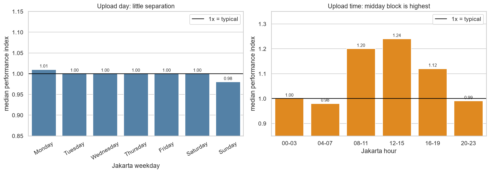
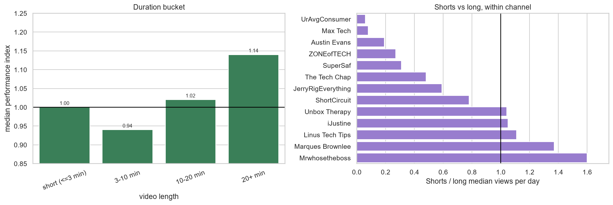
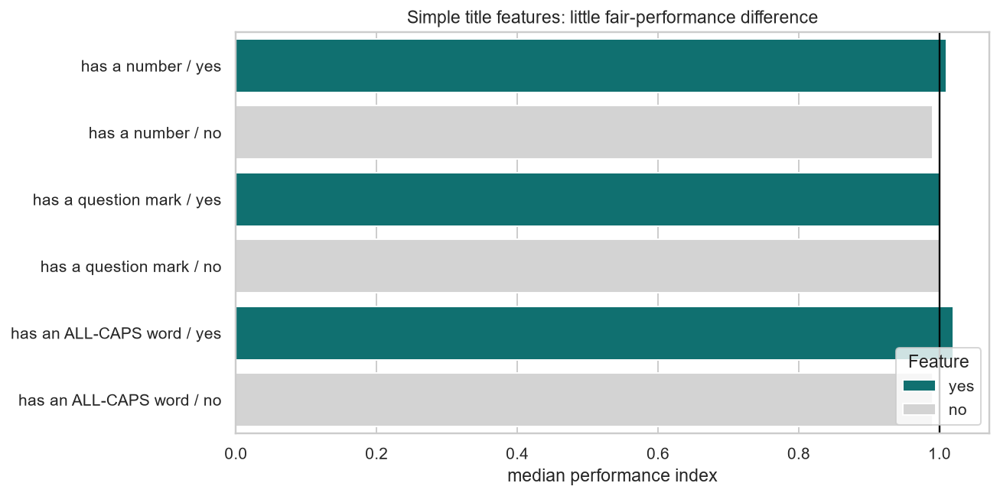
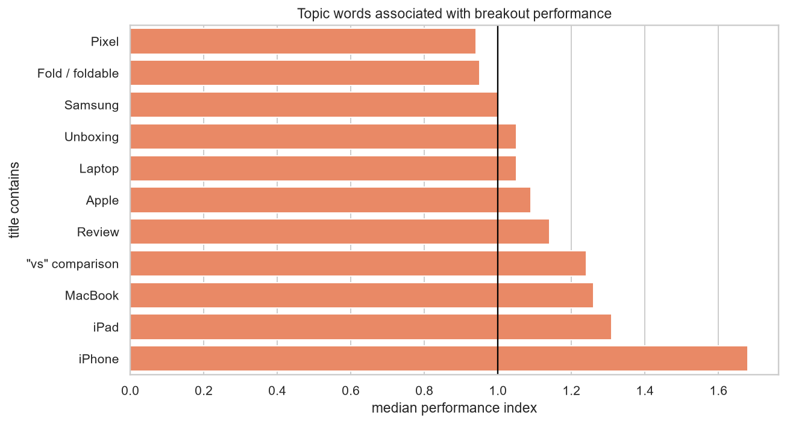
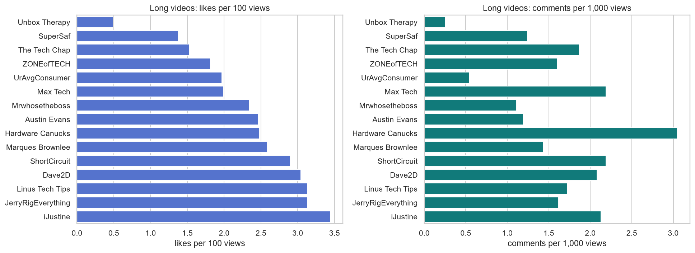
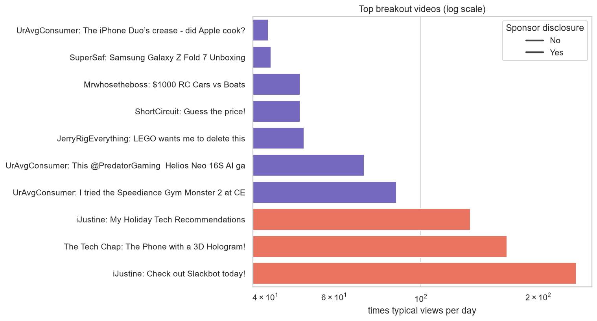

# YouTube Trend Analysis: Tech Reviews

What relates to video performance in YouTube's tech-review niche?

This portfolio project collects public metadata from 15 tech-review channels, stores it in SQLite, creates fair comparison metrics, and explores upload timing, video length, title patterns, engagement and breakout videos.

> Results show correlation, not causation. A topic, channel, launch event, sponsorship, season and upload time can overlap.

## Results at a glance

Snapshot: **3,000 videos from 15 channels**, collected on **October 19, 2026**.

After cleaning:

- **2,999** published videos remain. One scheduled video is excluded.
- **2,758** videos pass the cleaning rules: not live and at least 30 days old.
- **2,724** have a stable comparison group of at least five similar videos.
- Similar means same **channel + format + age group**.
- A breakout means `performance_index >= 3`: at least three times the typical views per day for similar videos.

| Question | Finding |
|---|---|
| Upload day | Weak relationship. Median fair index ranges from **0.98 to 1.01** by weekday. |
| Upload hour | **12:00–15:59 Jakarta time** is highest at **1.24x**, but channel schedules confound this result. |
| Video length | **20+ minute** videos have the highest fair median at **1.14x**; 3–10 minute videos are **0.94x**. |
| Shorts vs long | Shorts have higher median views/day in **5 of 13** age-matched channel comparisons. No universal winner. |
| Title features | Question marks show **1.00x** with or without them. Numbers and all-caps words show only small differences after normalization. |
| Product topics | Titles containing **iPhone** have a **1.68x** median fair index; topic also captures launch timing and demand. |
| Engagement | Likes: **2.45 per 100** long-video views vs **2.47** Shorts. Comments: **1.76 per 1,000** long-video views vs **0.55** Shorts. |
| Breakouts | **306 of 2,724** stable rows (**11.2%**) reach at least 3x typical performance. |

## Dashboard

Run the local Streamlit dashboard by double-clicking:

```text
dashboard.bat
```

Dashboard filters:

- Channel
- Short or long format
- Duration bucket
- Video age
- Publish date
- Sponsorship disclosure heuristic

Dashboard tabs:

1. Upload timing
2. Video length
3. Title patterns
4. Engagement
5. Breakouts

Dashboard reads the local SQLite database. It makes **no API calls** and includes a CSV download for filtered rows.



## Analysis charts

### Upload timing


The weekday result is close to 1x across all days. The hour-block result is more separated, but `Mrwhosetheboss` supplies 35% of uploads in the `16:00–19:00` block. That concentration makes upload hour a confounded pattern, not a causal recommendation.

### Video length



The fair index controls for channel, format and age group. It prevents a large channel or older video from automatically winning a comparison.

### Title patterns and topics





Simple punctuation and capitalization patterns have little fair-performance difference. Product topics are stronger associations, especially iPhone, but product launches and audience demand are alternative explanations.

### Engagement



Likes per view are similar between formats. Comments per view are much higher for long videos. Missing likes remain missing; they are never changed to zero.

### Breakouts



The largest observed breakout is iJustine's **“Check out Slackbot today!”** at approximately **250x** its typical comparison group. Its description contains a sponsorship disclosure. Other top breakouts also include disclosed brand collaborations, so breakout videos require manual review.

## Method

### Data collection

The project uses YouTube Data API v3 through plain Python `requests` calls.

For each channel, the collector:

1. Calls `channels.list` to get channel information and the uploads playlist.
2. Calls `playlistItems.list` to list the newest uploads. It does not use `search.list`, which costs 100 quota units.
3. Calls `videos.list` in batches of up to 50 IDs for metadata, duration, category and statistics.
4. Saves every raw API response before processing it.
5. Records a collection timestamp so age-based metrics are reproducible.

The full collection used **121 quota units**: 1 channel request, 60 playlist-page requests and 60 video-detail requests.

### Cleaning rules

- Exclude one scheduled video that was not published.
- Keep live streams in the table but exclude them from normal-upload analysis.
- Exclude videos younger than 30 days because their view counts are still changing quickly.
- Convert ISO 8601 durations such as `PT12M30S` into seconds.
- Convert UTC publish times to `Asia/Jakarta`.
- Define `short` as duration `<= 3 minutes`. The API does not provide a simple exact Shorts flag.
- Keep missing likes/comments as missing. Hidden likes are not zeros.
- Detect sponsorship disclosures in title/description using a text heuristic.

### Fair performance metric

```text
performance_index = views_per_day / typical_views_per_day
```

`typical_views_per_day` is the median for videos with the same:

- Channel
- Format: short or long
- Age group: 30–90 days, 90–180 days, 180–365 days or 1 year+

A minimum group size of five is required. `1.00` means typical. `3.00` means three times typical.

Raw `views_per_day`, `views_per_subscriber`, likes/views and comments/views remain available beside the normalized metric.

## Project structure

```text
config/channels.csv              15 approved channel IDs
src/youtube_api.py               YouTube API client and retry logic
src/collect.py                   Cached raw-data collector
src/load_db.py                   Idempotent SQLite loader
src/features.py                  Cleaning and feature engineering
src/db.py                        SQLite connection and MEDIAN aggregate
sql/schema.sql                   Database schema
sql/analysis.sql                 Named Step 5 analysis queries
notebooks/01_*.ipynb             Cleaning checks and decisions
notebooks/02_analysis.ipynb      Analysis tables, charts and findings
dashboard/app.py                 Streamlit dashboard
reports/figures/                 Saved PNG charts
docs/data_dictionary.md          Feature definitions
docs/results_summary.md          Compact measured-results summary
```

## Run locally on Windows

### 1. Install and configure

Double-click:

```text
setup.bat
```

Then open `.env` in Notepad and add your own YouTube API key:

```text
YOUTUBE_API_KEY=your_key_here
```

Never put the real key in code, notebooks, screenshots or Git. Full instructions:

[docs/api_key_setup.md](docs/api_key_setup.md)

Check the key:

```text
check_setup.bat
```

### 2. Collect data

Double-click:

```text
collect.bat
```

The collector caches responses in `data/raw/`. A completed snapshot can be reused without another API call. Raw API data is ignored by Git.

### 3. Build the database

Double-click:

```text
load_db.bat
```

The loader is idempotent: running it again does not duplicate rows.

### 4. Build features

Double-click:

```text
features.bat
```

This rebuilds `video_features` and the local processed CSV from the saved SQLite tables. No API calls occur.

### 5. View analysis

Double-click:

```text
notebooks.bat
```

Open `01_cleaning_and_features.ipynb` or `02_analysis.ipynb` in JupyterLab.

### 6. View dashboard

Double-click:

```text
dashboard.bat
```

## Reproducible technical checks

The project was validated with:

- Offline API retry, quota and error-path tests.
- A real 3,000-video collection using 121 quota units.
- Cache and resume tests with zero repeated API calls.
- Idempotent database-load tests.
- Seven feature-cleaning checks.
- All 15 named SQL queries.
- Independent SQL/Pandas median comparison.
- End-to-end notebook execution with `nbclient`: zero cell errors.
- Streamlit AppTest for default, channel, format, age, sponsorship and empty filters.
- Headless Streamlit HTTP health check: `ok`.

## Limitations

- Observational data cannot establish causation.
- The sample is limited to the newest 200 videos from each selected channel.
- The channels differ in size, upload schedule, format mix and audience.
- `duration <= 3 minutes` approximates Shorts; it is not an exact Shorts flag.
- YouTube changed Shorts view counting on March 31, 2025. Starts and replays became views; the older metric remains “engaged views.” This makes older and newer Shorts less directly comparable.
- Subscriber counts are rounded by YouTube.
- Likes can be hidden and comments can be disabled.
- Sponsorship detection searches title and description text. It misses undisclosed deals and can flag a partner mention without proving paid distribution.
- API statistics are a snapshot and change over time.
- Recent videos and seasonal product launches can dominate apparent performance.

## YouTube API data policy

Raw responses, SQLite data and processed CSV files remain local and are excluded from Git. Refresh or delete stored YouTube API statistics according to current YouTube API Services policies before publishing a new snapshot. The code and documentation do not include the API key.

## License

This repository contains analysis code and documentation. YouTube metadata and statistics are provided by YouTube and remain subject to YouTube's terms and API policies; they are not relicensed by this project.
